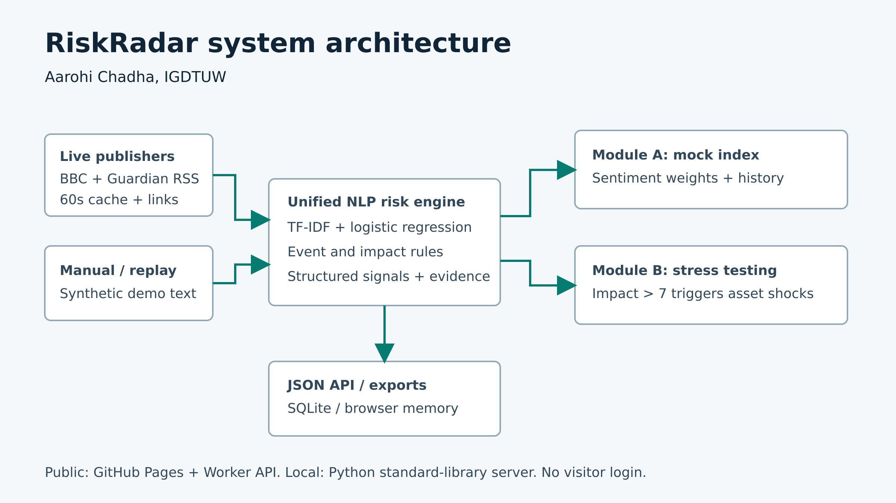

# RiskRadar - S&P Global & Crisil Campus Hackathon

**Candidate Name:** Aarohi Chadha  
**College Email ID:** PENDING - supply actual college email before submission  
**College / Campus:** Indira Gandhi Delhi Technical University for Women (IGDTUW)  
**Demo Video Link:** PENDING - upload the 10-minute screen recording to YouTube as Unlisted  
**Slide Deck:** [PDF](docs/presentation.pdf) or [PPTX](docs/RiskRadar-Presentation.pptx)  
**Live Dashboard:** https://aarohichadha.github.io/igdtuw-aarohi-chadha-hackathon/

## 1. Project Overview / Problem Statement & Approach

Financial news arrives as unstructured text from different publishers. Analysts must interpret events, connect them with exposures and decide what warrants investigation. RiskRadar demonstrates one processing engine that converts incoming text into structured sentiment, event category and impact estimates, while preserving source metadata and evidence.

BBC Business and Guardian Business RSS provide two live sources. A learned sentiment model outputs a score from -1 to 1. Transparent keyword rules classify events and estimate severity from 1 to 10. The dashboard exposes probabilities, matching rules and original publisher links.

Module A changes normalized weights in a ten-stock mock index using company sentiment. Module B applies simplified asset shocks when impact exceeds seven and shows portfolio value before and after stress. Both modules demonstrate decision support under explicit assumptions.

## 2. Architecture & Tech Stack



- Local: Python 3.10+ standard-library HTTP server, XML parsing and SQLite persistence.
- Public: HTML/CSS/JavaScript on GitHub Pages, ESM Worker API for live ingestion, no visitor login or client credentials.
- Training: scikit-learn 1.8.0 and NumPy 2.3.5. Inference uses exported TF-IDF/logistic regression parameters.
- Data flow: publisher/manual inputs feed the shared NLP engine. Structured signals drive the two modules and JSON exports. Local mode persists signals in SQLite. Public mode holds browser state in memory.

Runtime has no pip dependencies. The training environment is separate. [Technical reference](docs/TECHNICAL.md) provides APIs and formulas.

## 3. Dataset Used

Public dataset: `zeroshot/twitter-financial-news-sentiment`, revision `ccbe24de388e287beb92dd393a335c376b350ac3`. The publisher declares MIT. Original CSVs and the publisher card are in `data/raw/`. Exact cleaned splits, model weights, evaluation statistics and a SHA-256 manifest are in `/data`.

Canonical exact-text deduplication, conflict removal and removal of 55 overlapping validation records yield **9,374 train texts** and **2,318 evaluation texts**. Fixed training settings do not tune on the evaluation split. The split is not temporal or entity-disjoint. Original tweet content retains applicable rights.

`data/replay.json` contains eight explicitly synthetic demo records. `data/portfolio.json` holds a synthetic $10m portfolio: $4m loans, $3m bonds, $2m equity and a $1m derivative. Duration, spread duration, equity beta and signed derivative rate sensitivity are explicit inputs. Event/impact rules and scenario shocks are assumptions, without market calibration.

Live sources: BBC Business RSS and Guardian Business RSS. Source URLs and publication times remain attached to records. Freshness depends on publishers and a 60-second cache. An outage produces an explicit error.

See [dataset provenance](docs/DATASET.md), [manifest](data/manifest.json) and [notices](THIRD_PARTY_NOTICES.md). All fixed input datasets and reproducible demo outputs are included in `/data`.

## 4. Quickstart & Installation

Runtime: **Python 3.10+**, tested on Linux with Python 3.12. Application inference uses only the standard library. Node 20+ is needed only for JS verification. Windows commands are supplied but not tested on Windows.

```bash
git clone https://github.com/aarohichadha/igdtuw-aarohi-chadha-hackathon.git
cd igdtuw-aarohi-chadha-hackathon
python -m pip install -r requirements.txt
python server.py
```

Open http://localhost:8000. On Windows, use `py` instead of `python` if needed. For another port, run `python server.py --port 8080`.

Choose **Run replay**, then select the war/sanctions event. Fetch BBC and Guardian using **Fetch live**. **Start live polling (60s)** refreshes both while the page remains open. **Export JSON** saves signals, stress results and all weight history.

### Reproduce training from included data

```bash
python -m venv .venv
# Activate .venv using your operating system's command.
python -m pip install -r requirements-training.txt
python scripts/train_model.py --cache data/raw
```

### Verification

```bash
python -m unittest discover -s tests -v
node tests/browser-engine.mjs
python scripts/replay.py
python scripts/build_worker.py
node tests/worker-api.mjs
```

With `python server.py` running, use `python tests/integration.py` in another terminal. Tests check calculation/API behavior, not investment performance.

## 5. Key Results & Domain Impact

- Held-out sentiment accuracy **82.05%**, macro-F1 **0.761** on 2,318 texts. These measure sentiment labels, not event/impact accuracy or portfolio returns.
- Synthetic geopolitical stress: **$10m before, $8.98m after**, loss **$1.02m (10.2%)**. Assumed equity shock -10%, rate shock +2 percentage points, spread shock +1.5 percentage points.
- Mock index weights normalize to 100%. Replay gives AAPL 13.85%, MSFT 13.61% and JPM 5.07%, with every position in exported history.
- Both live publishers, JSON exports, nine Python unit tests, API integration and Python/JavaScript replay parity have been checked.

The common signal format helps risk analysts inspect incoming news consistently. Asset-level scenario losses connect event assumptions to portfolio exposures. The mock index shows how another consumer uses sentiment. No measured analyst time saving, trading outperformance or production risk-model validity is claimed.

### Limitations & Next Steps

Rules can miss negation and mixed events. Simple aliases do not resolve arbitrary entities. Tweet-trained sentiment may shift on news articles and probabilities are not calibrated. Portfolio valuation omits nonlinear options, convexity and liquidity. Next steps are temporal sentiment evaluation and market calibration of severity and shocks.

### Recording & Submission

Use the [ten-minute recording script](docs/VIDEO-WALKTHROUGH.md) and [five-minute live pitch](docs/DEMO.md). The guidelines require an **Unlisted YouTube screen recording**. The dashboard link does not replace it. Replace both PENDING fields above and test the video without sign-in before submitting.

### AI Assistance Disclosure

AI assistance helped with implementation, documentation, testing and presentation preparation. Sources, metrics and limitations are documented. The candidate should review the work and explain its design and assumptions during the individual jury pitch.

### License

Project code: [MIT](LICENSE), copyright Aarohi Chadha. Third-party data and publisher content retain their applicable rights and attribution.
